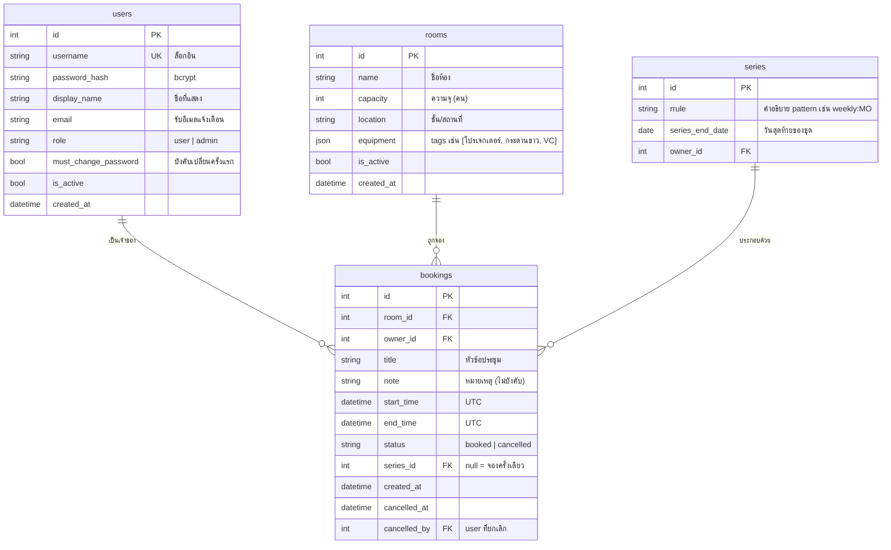

# Design — ระบบจองห้องประชุม (meeting-room-booking)

> เอกสารนี้คือแบบสถาปัตยกรรมและการออกแบบทางเทคนิค
> บริบท/เหตุผลอยู่ใน `context.md` — รายการงานอยู่ใน `task.md`

## 1. ภาพรวมสถาปัตยกรรม

```
┌─────────────────────┐         ┌──────────────────────────┐
│  Frontend (React)   │  HTTP   │  Backend (FastAPI)       │
│  Vite + TS +        │ ──────► │  - REST API (/api/*)     │
│  Tailwind CSS       │  JSON   │  - JWT auth              │
│  (static files)     │         │  - กติกาการจอง           │
└─────────────────────┘         └──────────┬───────────────┘
                                           │ SQLAlchemy
                              ┌────────────▼───────────────┐
                              │  PostgreSQL 16             │
                              └────────────────────────────┘
                                           │ SMTP (optional)
                              ┌────────────▼───────────────┐
                              │  SMTP องค์กร (email)       │
                              └────────────────────────────┘
```

- **โครงสร้าง monorepo 2 โฟลเดอร์:** `backend/` (Python/FastAPI) และ `frontend/` (React/Vite) — ใน repo เดียว พร้อม `docker-compose.yml` ที่รูท
- รอบแรก: รัน local บนเครื่อง dev (uvicorn + vite dev server + Postgres ผ่าน Docker)
- รอบ deploy: `docker-compose.yml` เดียวครบ 3 service: `db`, `backend`, `frontend` (nginx เสิร์ฟ static + proxy `/api` ไป backend)

## 2. Tech stack

| ชั้น | เทคโนโลยี | หมายเหตุ |
|---|---|---|
| Frontend | React 18 + Vite + TypeScript + Tailwind CSS | SPA, responsive |
| Backend | Python 3.12 + FastAPI + Uvicorn | REST JSON |
| ORM/DB | SQLAlchemy 2.0 + Alembic (migration) + PostgreSQL 16 | ใช้ transaction ตอนสร้างการจอง |
| Auth | JWT (access token) ใน httpOnly cookie + bcrypt (passlib) | อายุ token 8 ชม. — พอสำหรับวันทำงาน |
| Email | มาตรฐาน `smtplib` ผ่าน env config | ส่งไม่ได้ = log error แล้วทำงานต่อ (ไม่ fail การจอง) |
| เวลา | เก็บ UTC ใน DB, แสดง/รับเป็น `Asia/Bangkok` | ทุก API ส่ง ISO 8601 พร้อม offset |

## 3. โมเดลข้อมูล (Data model)



### กติกาที่บังคับที่ระดับข้อมูล

- **Overlap constraint:** เขียนตรวจสอบใน transaction แบบ `SELECT ... FOR UPDATE` ที่การจอง active ของห้องนั้น แล้วเช็คซ้ำอีกครั้งก่อน INSERT — กัน race condition เมื่อสองคนจองพร้อมกัน
- สถานะยกเลิกเป็น **soft delete** (`status=cancelled`) — ไม่ลบแถว เพื่อเก็บประวัติ

## 4. กติกาการจอง (Business rules) — แหล่งความจริงเดียว

กฎทั้งหมดอยู่ที่ `backend/app/services/booking_rules.py` ที่เดียว เพื่อให้ API และ frontend ตรวจด้วย logic เดียวกัน (frontend ใช้เพื่อ UX เบื้องต้น, backend ตรวจอีกครั้งเป็นขั้นสุดท้าย):

| กฎ | นิยาม |
|---|---|
| **R1 Hard conflict** | การจองใหม่ในห้องเดียวกัน **ห้าม** ซ้อนทับการจองที่ `status=booked` รายการใด — เงื่อนไข: `new.start < old.end AND old.start < new.end` |
| **R2 Buffer 15 นาที** | ห่างกันอย่างน้อย 15 นาที: `new.start >= old.end + 15min` หรือ `new.end + 15min <= old.start` (ใช้กับห้องเดียวกัน) |
| **R3 ล่วงหน้า** | `new.start` ต้องอยู่ระหว่าง "ตอนนี้" ถึง "ตอนนี้ + 30 วัน" |
| **R4 ระยะเวลา** | `30 นาที <= (end - start) <= 4 ชั่วโมง` |
| **R5 จองซ้ำ** | สร้างเป็นชุดรายสัปดาห์: วันในสัปดาห์ + เวลาเดิม + วันสิ้นสุด (≤ 90 วันข้างหน้า) — แต่ละวันเป็น Booking แยกใน series เดียว; **วันที่ชน R1/R2 ระบบแสดงรายการวันชนและผู้ใช้เลือก "สร้างโดยข้ามวันนั้น" ได้** |
| **R6 ยกเลิก** | เจ้าของยกเลิกของตัวเองได้เมื่อ `now < start`; Admin ยกเลิกได้ทุกรายการ (ระบุ `cancelled_by`); ประชุมเริ่มแล้ว (`now >= start`) ยกเลิกไม่ได้; ยกเลิกทั้ง series ได้ด้วยคำสั่งเดียว |
| **R7 ห้อง inactive** | ห้องที่ `is_active=false` จองใหม่ไม่ได้ — การจองเดิมคงสถานะเดิม |

> ข้อควรระวังเรื่อง buffer กับ recurring: การสร้างชุดใหม่ต้องเช็ค R1+R2 **กับทั้งชุดเดิมที่มีอยู่** รวมกันในการตรวจแต่ละวัน

## 5. API design (REST, prefix `/api`)

| Method | Path | สิทธิ์ | คำอธิบาย |
|---|---|---|---|
| POST | `/auth/login` | สาธารณะ | ล็อกอิน → JWT cookie |
| POST | `/auth/logout` | ล็อกอินแล้ว | เคลียร์ cookie |
| POST | `/auth/change-password` | ล็อกอินแล้ว | เปลี่ยนรหัส (ใช้ตอนบังคับครั้งแรกด้วย) |
| GET | `/me` | ล็อกอินแล้ว | ข้อมูลตัวเอง + role + flag เปลี่ยนรหัส |
| GET | `/rooms` | ล็อกอินแล้ว | รายการห้อง (พร้อม availability ตอนระบุ `?date=`) |
| POST | `/rooms` | admin | สร้างห้อง |
| PATCH | `/rooms/{id}` | admin | แก้/ปิดห้อง (`is_active`) |
| GET | `/bookings?date=&room_id=` | ล็อกอินแล้ว | การจองตามวัน (ทุกห้อง หรือห้องเดียว) |
| GET | `/bookings/week?start=&room_id=` | ล็อกอินแล้ว | การจองช่วงสัปดาห์ (สำหรับ weekly view) |
| GET | `/bookings/mine` | ล็อกอินแล้ว | การจองของตัวเอง (อนาคต + อดีต 30 วัน) |
| POST | `/bookings` | ล็อกอินแล้ว | สร้าง (ครั้งเดียว หรือชุด) — ตอบ 409 พร้อมรายการวันชนกรณี recurring |
| DELETE | `/bookings/{id}` | เจ้าของ/admin | ยกเลิกรายการเดียว (ตาม R6) |
| POST | `/series/{id}/cancel` | เจ้าของ/admin | ยกเลิกทั้งชุดที่ยังไม่เริ่ม |
| GET | `/users` | admin | รายชื่อผู้ใช้ |
| POST | `/users` | admin | สร้างบัญชี (รหัสเริ่มต้น + `must_change_password=true`) |
| POST | `/users/{id}/reset-password` | admin | รีเซ็ตรหัสให้ใหม่ (บังคับเปลี่ยนอีกครั้ง) |
| PATCH | `/users/{id}` | admin | เปิด/ปิดบัญชี, เปลี่ยน role |

- Error format เดียวกัน: `{"detail": "...", "conflicts": [...]}` (conflicts เฉพาะ 409 ของการจอง)
- ทุก endpoint ตรวจ JWT จาก httpOnly cookie; 401 → frontend redirect ไป login

## 6. หน้าจอ (Frontend)

| หน้า | เส้นทาง | เนื้อหา |
|---|---|---|
| ล็อกอิน | `/login` | username/password |
| บังคับเปลี่ยนรหัส | `/change-password` | โผล่อัตโนมัติเมื่อ `must_change_password` |
| **ตารางรายวัน** (หน้าแรก) | `/` | Timeline แนวนอน 08:00–20:00 — แถวต่อห้อง (เลือกได้ว่าดูห้องเดียวหรือทุกห้อง), บล็อกการจองคลิกได้เพื่อดูรายละเอียด, ช่องว่างคลิกเพื่อเริ่มจอง, สลับวันด้วยปุ่ม ‹ › และ "วันนี้" |
| **ตารางรายสัปดาห์** | `/week` | คอลัมน์ 7 วัน × แถวต่อห้อง (หรือต่อวันเลือกห้องเดียว) |
| สร้างการจอง (Dialog) | — | เลือกห้อง, วันเวลา, หัวข้อ, หมายเหตุ; สวิตช์ "จองซ้ำรายสัปดาห์" → เลือกวัน + วันสิ้นสุด; ตรวจสดด้วยกฎ R1–R4; ถ้าชน (recurring) แสดงรายการวันชน + checkbox ยกเว้นวันนั้น |
| การจองของฉัน | `/my-bookings` | รายการอนาคต/อดีต + ปุ่มยกเลิก (ซ่อนตาม R6) |
| Admin: ห้อง | `/admin/rooms` | CRUD ห้อง + อุปกรณ์ + เปิด/ปิด |
| Admin: ผู้ใช้ | `/admin/users` | สร้างบัญชี (แสดงรหัสเริ่มต้นให้ copy), รีเซ็ตรหัส, เปิด/ปิด |
| Admin: การจองทั้งหมด | `/admin/bookings` | ตารางทุกการจอง + ยกเลิกแทนคนอื่น |

- **UI ภาษาไทย** — คำเทคนิคคงอังกฤษ (Login, หมายเหตุ ฯลฯ)
- Responsive: timeline รายวันบนมือถือเลื่อนแนวนอนได้ในคอนเทนเนอร์ของตัวเอง

## 7. อีเมลแจ้งเตือน

| เหตุการณ์ | ผู้รับ | เนื้อหา |
|---|---|---|
| จองสำเร็จ (ครั้งเดียวหรือแต่ละวันของชุด) | ผู้จอง | ห้อง, วันเวลา, หัวข้อ, ลิงก์เข้าระบบ |
| ยกเลิก (รายวันหรือทั้งชุด) | ผู้จอง | รายการที่ถูกยกเลิก + โดยใคร |
| Admin สร้างบัญชี / รีเซ็ตรหัส | ผู้ใช้ใหม่ | ชื่อผู้ใช้ + รหัสเริ่มต้น + คำสั่งเปลี่ยนรหัส |

- Config ผ่าน env: `SMTP_HOST`, `SMTP_PORT`, `SMTP_USER`, `SMTP_PASS`, `SMTP_FROM`
- **ส่งพลาด = log warning แล้วทำงานต่อ** — การจองไม่ควรพังเพราะอีเมล

## 8. ความปลอดภัย

- รหัสผ่าน: bcrypt (cost 12) — ไม่เก็บ plaintext เด็ดขาด
- JWT ใน httpOnly + SameSite=Lax cookie, อายุ 8 ชม.
- ทุก mutation ตรวจสิทธิ์ฝั่ง backend เสมอ (frontend ซ่อนปุ่มเป็นแค่ UX)
- Rate limit เบื้องต้นที่ `/auth/login` (เช่น 10 ครั้ง/นาที/IP) — กัน brute force
- SQL ทั้งหมดผ่าน SQLAlchemy ORM (ไม่มี string concat)

## 9. Deployment

- **Local dev:** `docker compose up db` (แค่ Postgres) + `uvicorn` + `npm run dev` — เหมาะกับการทดสอบบนเครื่องนี้ก่อน
- **Production:** `docker compose up -d --build` — ครบ 3 service, volume สำหรับข้อมูล Postgres, env file แยก `.env.production`
- Migration รันอัตโนมัติก่อน start backend (`alembic upgrade head` ใน entrypoint)
- Backup: `pg_dump` รายวันผ่าน cron (นอกขอบเขต MVP แต่เตรียมจุด hook ไว้)

## 10. การทดสอบ (ขั้นต่ำที่ต้องมี)

- **Backend (pytest):** กฎ R1–R6 ทุกข้อ — โดยเฉพาะ overlap + buffer ที่ขอบ (เช่น 14:59 กับ 15:00), race condition ด้วย concurrent request, สิทธิ์ยกเลิก, recurring ที่มีวันชน
- **Frontend (Vitest):** ฟังก์ชันตรวจ conflict ฝั่ง client + ฟอร์มจองซ้ำ
- **API test:** login → create → conflict 409 → cancel → 403 กรณีไม่มีสิทธิ์
